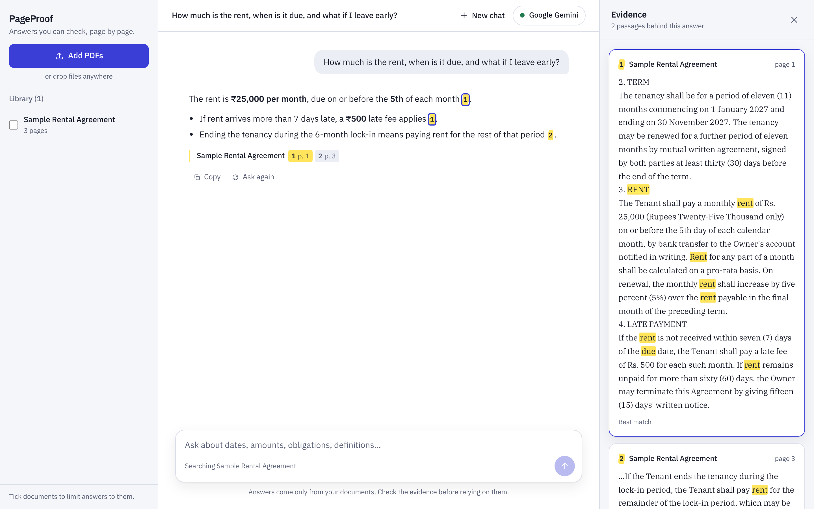
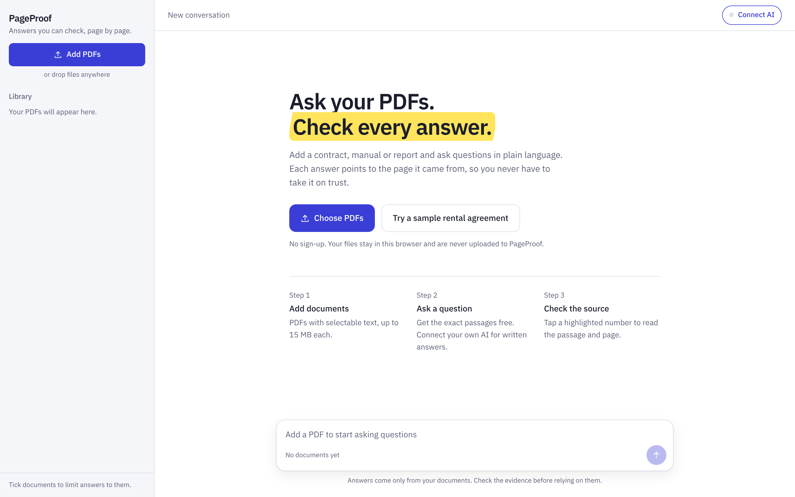
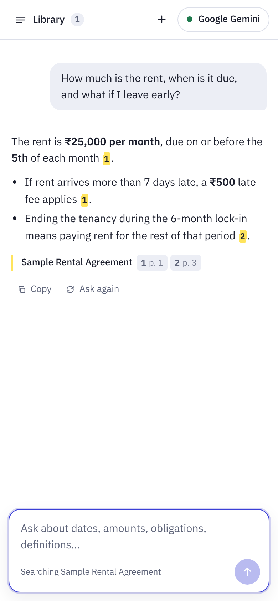
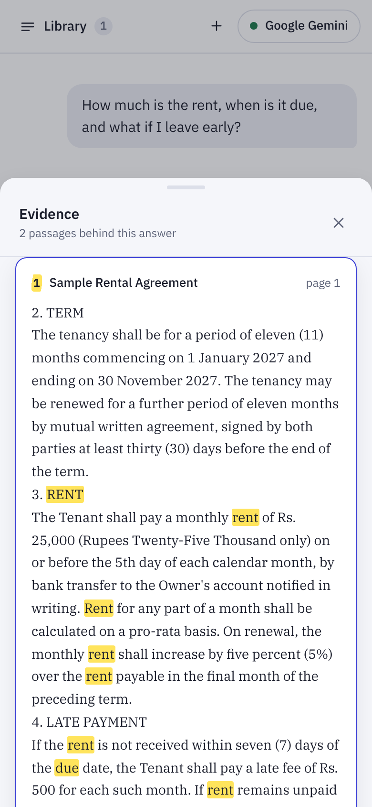
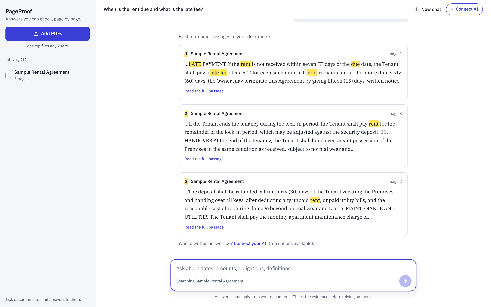
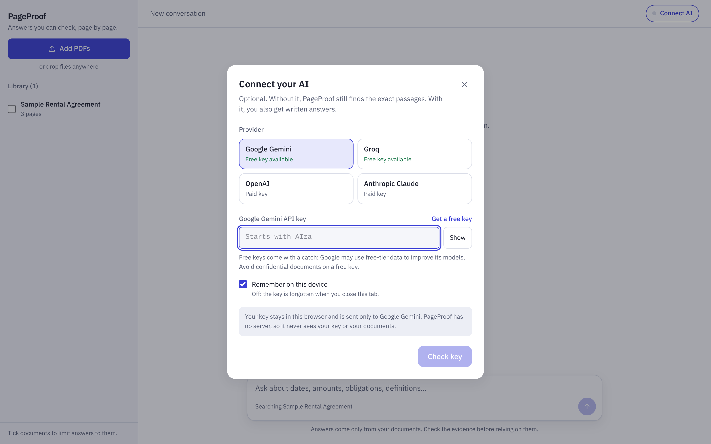
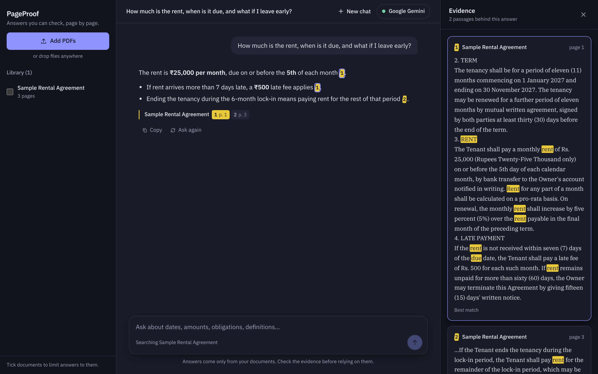

# PageProof

**Ask your PDFs. Check every answer. No sign-up, no server, no API key needed.**

Add PDFs and ask questions in plain language. PageProof finds the exact passages and pages that answer you. Connect your own AI key (free options available) and you also get a written answer with **highlighted citations**. Tap a number to read the passage it came from, so you never have to take the answer on trust.



> **Live demo:** [pageproof-app.vercel.app](https://pageproof-app.vercel.app). Click **Try a sample rental agreement** to test it in seconds.

---

## Why it's different

- **Private by design.** PDFs are read and searched **inside your browser**. They are never uploaded to a PageProof server, because there isn't one.
- **Free to run.** Search works with no key at all. Hosting is a static site, so it costs nothing.
- **Bring your own AI.** Connect Google Gemini, Groq, OpenAI or Anthropic Claude with your own key. Gemini and Groq offer free keys. The key stays in your browser and goes only to that provider.
- **Answers you can verify.** Every answer cites the page. The AI is told to answer only from your documents and to say so when the answer isn't there.

## Why businesses use this

- **Legal & HR teams:** "What's the notice period in this contract?"
- **Customer support:** answer questions from product manuals instantly
- **Finance:** pull key dates and amounts out of long reports
- **Sensitive documents:** files never leave the device

## Features

**Two ways to get answers**
- **No key:** the best matching passages, opened at the matching sentence, with your question's words highlighted
- **With your AI key:** a written answer that **streams in word by word**, with clickable citations, plus **Stop**, **Ask again** and **Copy**
- **Evidence panel** shows each cited passage, its page and its relevance

**Connect AI**
- Choose Gemini, Groq, OpenAI or Claude, paste a key, and PageProof checks it straight away
- The model list loads live from the provider, with a fast, low-cost default picked for you
- Choose whether the key is remembered on this device or forgotten when the tab closes
- Plain-language errors for a wrong key, rate limits, or no connection

**Easy document handling**
- **Drag and drop PDFs anywhere**, or pick several at once
- Live indexing progress for each file, and clear errors you can dismiss
- **Try a sample** button loads a demo rental agreement in one click
- Tick documents to limit answers to them; filter a long library; delete with confirmation
- Library and conversation survive a refresh

**Built properly**
- Works on phone, tablet and desktop (library drawer and evidence sheet on mobile)
- Automatic light and dark mode
- Keyboard friendly: <kbd>/</kbd> to focus the question box, <kbd>Enter</kbd> to send, <kbd>Shift</kbd>+<kbd>Enter</kbd> for a new line, <kbd>Esc</kbd> to close panels
- Screen-reader labels, visible focus, and reduced-motion support

| First visit | Phone | Evidence on phone |
|---|---|---|
|  |  |  |

| No key: matching passages | Connect your AI |
|---|---|
|  |  |



## Tech stack

| Layer | Technology |
|---|---|
| App | Next.js (fully static pages), React, TypeScript, Tailwind CSS |
| PDF reading | unpdf (PDF.js), in the browser |
| Storage | IndexedDB in the browser (idb-keyval) |
| Search | BM25 keyword ranking, in the browser |
| AI (optional) | Your own key: Gemini, Groq, OpenAI or Claude, called directly from the browser with streaming |
| Hosting | Any static host. Vercel free tier works |

## How it works

```
Add PDF ──► read text page by page (in the browser)
        ──► split into overlapping passages ──► save in this browser (IndexedDB)

Question ──► rank passages with BM25 keyword search
         ├─ no key:   show the best passages, opened at the matching sentence
         └─ your key: send the top passages to your AI with numbered references
                      ──► streamed answer with [1] [2] citations ──► evidence panel
```

This pattern is called **RAG (Retrieval-Augmented Generation)**. Here, the retrieval runs entirely on the user's device.

## Project structure

```
src/
  app/page.tsx                App shell: uploads, chat state, layout
  components/
    ConnectAI.tsx             Bring-your-own-key dialog
    Library.tsx               Document list, indexing progress, filter
    Conversation.tsx          Answers, passages, markdown, citations
    Composer.tsx              Question box with stop/send
    EvidencePanel.tsx         Source passages with highlighted words
    Toasts.tsx                Notifications
  lib/
    library.ts                PDF reading, browser storage, passage search
    search.ts                 BM25 ranking and tokenizer
    providers.ts              Gemini, Groq, OpenAI, Claude: models and streaming
    client.ts                 Prompt, saved chat, snippet and text helpers
    chunk.ts                  Passage splitting
    config.ts                 Limits and search settings
public/sample/                Demo rental agreement (fictional)
```

## Run it yourself

**You need:** Node.js 20+. Nothing else: no database, no keys.

```bash
git clone https://github.com/NDevWorks/pageproof.git
cd pageproof
npm install
npm run dev
```

Open http://localhost:3000 and click **Try a sample rental agreement**.
For written answers, click **Connect AI** and paste a key. A free Gemini key takes a minute at [aistudio.google.com/apikey](https://aistudio.google.com/apikey).

## Deploy

1. Push this repo to your GitHub.
2. In [Vercel](https://vercel.com), click **Add New → Project**, import the repo, and click **Deploy**.

No environment variables are needed.

## Limitations & next steps

This is a working demo. For a client project, I'd typically add:

- **Semantic search** (embeddings) alongside keyword search, so different wording still matches
- OCR for scanned PDFs, plus Word, Excel and web page support
- A shared team library with logins, if documents must be shared across devices
- A managed AI key on a server, with usage limits, for clients who don't want end users to bring keys

A note on free keys: Google may use data sent with free-tier Gemini keys to improve its models. The app warns users about this.

## Need something like this?

I build AI features like this into business apps: document Q&A, chatbots, summaries and automation.
**Get in touch on Upwork** or open an issue on this repo.

## License

MIT
