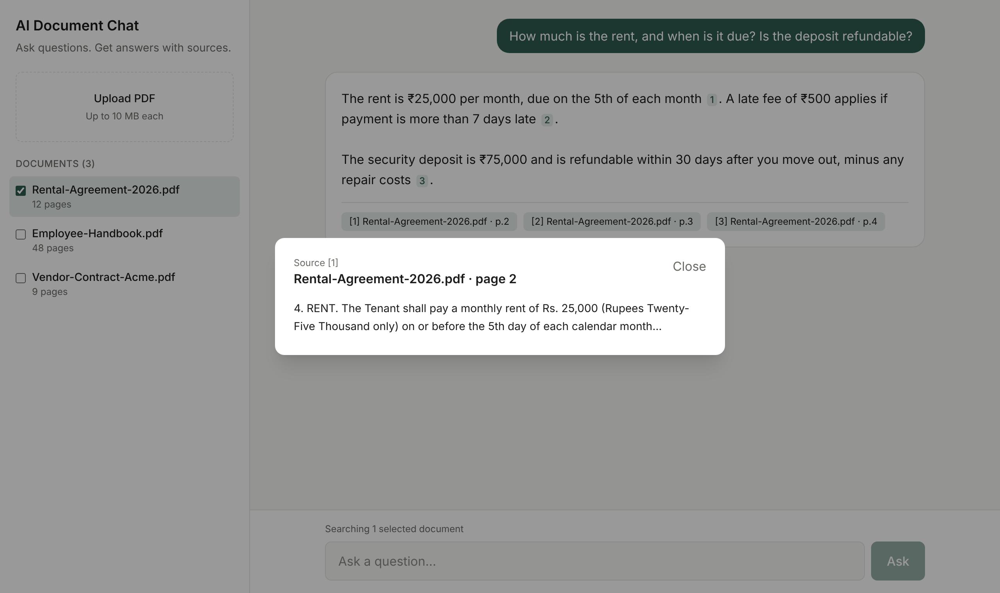

# AI Document Chat

Upload PDFs and ask questions in plain language. Every answer comes with **clickable sources** showing the exact document and page it came from, so you can trust what you read.


> **Live demo:** _coming soon_

---

## Why businesses use this

- **Legal & HR teams:** "What's the notice period in this contract?"
- **Customer support:** answer questions from product manuals instantly
- **Finance:** pull key dates and amounts out of long reports
- **Internal knowledge base:** a "ChatGPT for our documents" that only answers from your files

The model is told to answer **only** from your documents. If the answer isn't there, it says so instead of guessing.

## Features

- 📄 Upload multiple PDFs (up to 10 MB each)
- 💬 Ask questions and follow-ups in a chat interface
- 🔎 Inline citations like `[1]`. Click one to see the exact passage and page
- ✅ Search all documents or only the ones you select
- 🔁 Choose the AI provider: **OpenAI** or **Anthropic Claude**
- 📱 Works on desktop and mobile, with light and dark mode



## Tech stack

| Layer | Technology |
|---|---|
| Frontend | Next.js (App Router), React, TypeScript, Tailwind CSS |
| Backend | Next.js API routes (Node.js) |
| Database | Supabase Postgres + **pgvector** for semantic search |
| AI | OpenAI embeddings · OpenAI or Claude for answers |
| PDF parsing | unpdf |
| Hosting | Vercel (free tier works) |

## How it works

```
Upload PDF ──► extract text per page ──► split into overlapping chunks
          ──► create embeddings (OpenAI) ──► store in Supabase (pgvector)

Question ──► embed question ──► find the most similar chunks
         ──► send them to the AI with numbered references
         ──► answer with [1] [2] citations ──► show sources
```

This pattern is called **RAG (Retrieval-Augmented Generation)**.

## Project structure

```
src/
  app/
    page.tsx                  Chat UI
    api/documents/route.ts    Upload + list documents
    api/documents/[id]/       Delete a document
    api/chat/route.ts         Answer questions with sources
  lib/
    ai.ts                     Embeddings + OpenAI/Claude answers
    chunk.ts                  Text splitting
    pdf.ts                    PDF text extraction
    supabase.ts               Database client (server only)
    config.ts                 Limits and model settings
supabase/schema.sql           Database tables and search function
```

## Run it yourself

**You need:** Node.js 20+, a free [Supabase](https://supabase.com) project, and an [OpenAI API key](https://platform.openai.com/api-keys).

1. **Clone and install**
   ```bash
   git clone https://github.com/NDevWorks/ai-document-chat.git
   cd ai-document-chat
   npm install
   ```

2. **Set up the database**
   In Supabase, open **SQL Editor → New query**, paste the contents of [`supabase/schema.sql`](supabase/schema.sql), and click **Run**.

3. **Add your keys**
   ```bash
   cp .env.example .env.local
   ```
   Fill in `SUPABASE_URL`, `SUPABASE_SERVICE_ROLE_KEY` (Project Settings → API), and `OPENAI_API_KEY`.

4. **Start**
   ```bash
   npm run dev
   ```
   Open http://localhost:3000 and upload a PDF.

### Use Claude instead of OpenAI for answers

Set `LLM_PROVIDER=anthropic` and `ANTHROPIC_API_KEY` in `.env.local`. OpenAI is still used for embeddings.

## Deploy to Vercel

1. Push this repo to your GitHub.
2. In [Vercel](https://vercel.com), click **Add New → Project** and import the repo.
3. Add the same environment variables from `.env.local`.
4. Click **Deploy**.

## Limitations & next steps

This is a working demo. For production use, I'd typically add:

- User login and per-user documents (Supabase Auth + row-level security)
- OCR for scanned PDFs
- Word, Excel and web page support
- Streaming answers and rate limiting
- Usage tracking and admin dashboard

## Need something like this?

I build AI features like this into business apps: document Q&A, chatbots, summaries and automation.
**Get in touch on Upwork** or open an issue on this repo.

## License

MIT
